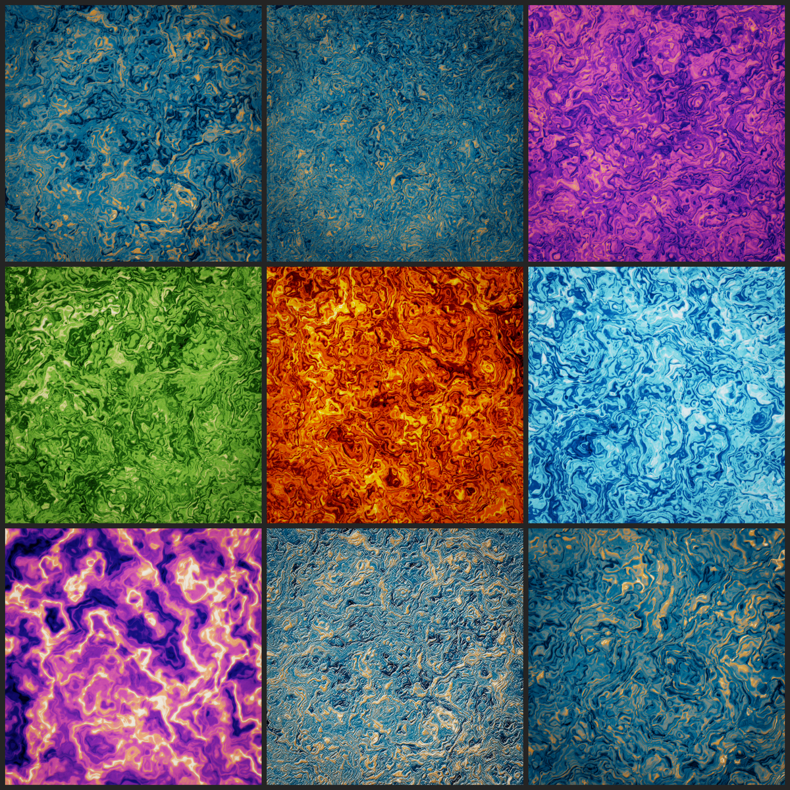

# Keenly

**CUDA 生成艺术工作室** —— 程序化生成电影画幅与 A1 海报尺寸的背景：
胶片颗粒、磨砂质感、有机流动、液态金属；并为战棋游戏量产**技能图标**
（4 色系 × 18 符号 × 4 级边框，RGBA，128/64px）。一台可复现的「审美机器」。

核心设计一句话：**每个像素都是 `(x, y, seed)` 的纯函数**——
GPU 与 CPU 参考**逐位一致**（maxAbs = 0），同一个 seed 无限复现，
**换 seed 就是换构图，风格不变**。

CUDA 是这里的**执行器，不是设计者**：同一套 shader 也能在 CPU 上跑，
`--cpu` 就是那条路径，输出与 GPU **逐字节相同**（`verify.ps1` 用 SHA256 校验）。
GPU 的收益高度集中在两处——反应扩散迭代（140×）和 A1 印刷母版（21×）；
图标量产是 I/O 主导，不需要 GPU。这个不对称在
[「为什么是 CUDA」](#为什么是-cuda以及哪里不需要它) 里有实测数据。



---

## 快速开始

```powershell
# 构建（任选其一）
powershell -ExecutionPolicy Bypass -File scripts\build_direct.ps1   # 直接 nvcc
powershell -ExecutionPolicy Bypass -File scripts\build.ps1          # CMake + Ninja

# 电影画幅（2.39:1，16-bit PNG）
.\bin\keenly.exe --preset cinema --width 2560 --height 1072 --out out\film_frame.png

# A1 海报（594x841mm 比例）
.\bin\keenly.exe --preset dusk --width 2000 --height 2832 --out out\a1_poster.png

# 九宫格：一次看九种构图/风格组合
.\bin\keenly.exe --grid out\showcase_grid.png --tile 800

# 技能图标（RGBA；--family blue|red|gold|purple、--glyph、--tier 1..4）
.\bin\keenly.exe --icon --family gold --glyph crown --tier 3 --width 128 --height 128 --out out\icon.png

# 图标整批：4 色系 x 18 符号 + 64px 缩略 + contact sheet
.\bin\keenly.exe --icons-demo out\icons

# 回归门禁（改动后跑这个）
powershell -ExecutionPolicy Bypass -File scripts\verify.ps1

# 没有 NVIDIA 卡也能跑：--cpu 是完整渲染后端，输出与 GPU 逐字节相同
.\bin\keenly.exe --cpu --preset dusk --width 2000 --height 2832 --out out\a1_poster.png
```

A1 300 DPI 印刷母版：`--width 7014 --height 9933`（7000 万像素）。实测全链
约 1.9–2.3 秒，其中渲染 0.46s + 后期 0.39s + 编码/写盘 1.08s——**写盘才是瓶颈**，
GPU 渲染只占约 20%。`--cpu` 同尺寸约 10 秒（32 线程）。

---

## 架构

```
src/
  keenly.cu       CLI + 位级门禁 + 九宫格/图标 demo + PNG 写出
  noise.cuh       整数哈希、8 方向梯度噪声、fBm、ridged fBm、Worley、powi
  turing.cuh      Gray-Scott 反应扩散：Jacobi 模拟 + 网格采样（可平铺）
  pixel.cuh       调色板、分层构图、17 个场生成器（GPU/CPU 共享的像素着色）
  sdf.cuh         2D SDF 图元 + 18 个技能符号库（纯多项式 + IEEE sqrt）
  icon.cuh        图标合成：流体背景 + 符号 + 分级边框 + 圆角遮罩 -> RGBA
  post.cuh        每像素后期尾链（split-tone/颗粒/暗角/ACES，静帧与图标共用）
  render.h/.cu    field/icon kernel + post 链（bright/blur/compose）+ RD 模拟
  reference.cu    CPU 实现：串行参考（门禁用）+ 多线程后端（--cpu 用）
  png_writer.h    零依赖 PNG 写出（RGB/RGBA，8/16-bit，stored DEFLATE）
  compare.h       DiffStats / compareArrays（门禁比较）
  cuda_utils.h    CUDA_CHECK + GpuTimer
docs/
  pipeline.md     渲染管线技术文档（生成器/调色/后期/门禁原理）
  icons_plan.md   技能图标量产方案（尺寸/色系/配额/分阶段）
  experiments.md  实验记录：改了什么 → 指标怎么变 → 为什么
scripts/
  build.ps1 / build_direct.ps1   两种构建路径
  verify.ps1                      回归门禁（构建 + 位级门禁 + CPU/GPU 奇偶 + 冒烟）
  icon_stats.py                   图标质检（对比度/值域/64px 可读性）
tools/
  grid_stats.py / comp_stats.py / validate_rd.py   分析脚本（见 tools/README.md）
```

**数据流**（详见 [docs/pipeline.md](docs/pipeline.md)）：

```
噪声 (5 octave fBm，每 octave 旋转 14°)
  → 二级域扭曲 (two-level domain warp)          ← 有机流动感
  → 分层构图（宏观明暗布局 + 色相漂移 + 细节层）   ← 「画」与「噪声贴图」的区别
  → 调色板 (≤8 stop) + 双尺度浮雕光照
  → 后期链 (线性光):
      halation 红晕 + bloom → split-tone 青影橙光 → vividness
      → 胶片颗粒 (双尺度聚团 + 三层色差) → 暗角 → ACES
  → sRGB + TPDF dither → 8/16-bit PNG
```

**分层构图**是 v2 的灵魂：宏观形体决定画面明暗布局、全画幅左上方向光、
色相随大形体漂移——`--macro 0` 关掉（平铺感）、`--macro 1` 全开（绘画感）。

---

## 生成器 × 调色板

**17 个场生成器**（`--mode`；`keenly --modes` 打印带编号的实时清单）：

| mode | 质感 | 数学 |
|---|---|---|
| `warp` | 流动烟雾 / 有机流体（默认，验证过的审美基线） | 二级域扭曲 fBm |
| `ridge` | 大理石纹 / 岩层 | 扭曲 ridged fBm |
| `bands` | 流线条纹 / 木纹 / 等高线 | warpField 三角波等值线 |
| `frost` | 磨砂玻璃 | 细 Worley 晶面 + 微闪点 |
| `facet` | 凛冽几何：晶体切面 / 碎裂 | Worley + 每面受光 + 硬闪 |
| `prism` | 凛冽几何：雪佛龙 / 菱格 | 30° 旋转坐标三角波折叠 |
| `liquid` | 光照质感：液态金属 / 油膜 | 宽场 + 宽高光 + 加性 glint |
| `turing` | 有机斑纹：珊瑚 / 迷宫 / 斑点 | Gray-Scott 反应扩散（图灵斑） |
| `agate` | 墨流 / 玛瑙切片（suminagashi） | 双滴椭圆环 + 半径域扭曲 |
| `waves` | 脉冲星波形山脊（Joy Division） | 行廓线剪影 + 填充遮挡 |
| `truchet` | 电路 / 织物纹理 | 弧片 truchet 瓦片 + 反相格 |
| `shards` | 万花筒曼荼罗 | 16 重镜像折叠 + warp 采样 |
| `dots` | 丝网印刷半调（riso） | 旋转双点阵，半径∝流场色调 |
| `aura` | 极光丝带 / 地震仪辉光 | fBm 漂移的柔光带 + 细丝纹理 |
| `moire` | 双源干涉涟漪（op-art） | 两组圆环波乘积 |
| `deco` | 包豪斯拼贴 | 哈希瓦片几何母题 + 细缝 |
| `glow` | 柔光海报：黑心暗池 + 上下环绕色团 | 种子散布加性光团 + 软赢家混色 |

`glow` 模式配合 `--margin`（哑光白边）出「Daily color scheme」式海报。

**12 个调色板**（`--preset`）：`cinema`（青橙）、`dusk`（靛蓝-品红-珊瑚）、
`mono`（灰阶）、`ember`（火）、`ice`（冰川）、`moss`（森林）、
`gold`（神圣金）、`violet`（暗紫）；
glow 四方案：`aurora`（紫青绿）、`sepia`（暖棕奶油）、`flare`（紫粉橙）、
`tide`（深红青）。preset 附带各自的颗粒/光晕默认值，CLI 显式参数优先。

**胶片滤镜** `--film F`：在任何 preset/模式上强制统一 35mm 聚团颗粒规格。

**质感旋钮**：`--grain` / `--grain-scale`（35mm 聚团 ↔ 磨砂细颗粒）、
`--halation`（胶片高光红晕）、`--split-tone`（青影橙光）、`--saturation`、
`--macro`（构图强度）、`--relief`（浮雕）、`--warp` / `--view`（结构）。
全部清单见 `keenly --help`。

---

## 技能图标（战棋游戏）

一张图标 = **色系 × 符号 × 边框等级 × seed**，全部一个纯函数 kernel 出图
（`icon.cuh`，含背景/符号/边框/遮罩/后期，单张 ~0.1 ms）：

| 部件 | 内容 |
|---|---|
| 色系 | `blue`（冰霜）、`red`（火焰）、`gold`（神圣）、`purple`（暗影），各带一套点缀色（描边/高光/辉光/阴影） |
| 背景 | 统一**流体**（warp 有机流动；red 为 liquid 流动+高光）——Worley 系在图标尺寸下是难看的 Voronoi |
| 符号 | `src/sdf.cuh` 18 个：sword/axe/bow/shield/flame/droplet/snow/bolt/sparkle/moon/sun/eye/heart/skull/cross/rune/crown/potion |
| 边框 | `--tier 1..4`：素描边 → 双环角钉 → 菱形角饰+外发光 → 宝石嵌角（顺带做稀有度） |
| 尺寸 | 128×128 主力 + 64×64 直渲（纯函数分辨率无关，直渲比缩放锐）；`--mask round\|rect`、`--radius` 圆角三档 |

图标输出 **8-bit RGBA**（alpha = 遮罩覆盖率，1px AA；RGB 通道带 TPDF
dither）。可读性纪律：符号笔画 ≥5px@128、亮描边、背景压暗、符号区颗粒减弱、
颗粒聚团随尺寸线性缩放（64px 减半、32px 再半幅）。量产方案（配额 160 张、
manifest 驱动）见 [docs/icons_plan.md](docs/icons_plan.md)，质检脚本
`scripts\icon_stats.py`。

**通用图标管线**（`--gicon`）：不走色系家族，背景改为程序化风格
（`--bg fluid|swirl|bands|rings|mosaic|glow`，glow 复用海报的
`--scheme aurora|sepia|flare|tide`），前景为纯白/纯黑平涂剪影，`--seed`
即变体 id、`--tier 0` 无框。批量：`--rainbow-demo` / `--glow-demo`。

---

## 工程纪律

**位级门禁**。Keenly 用严格 IEEE 数学编译（`--fmad=false`，不加 fast-math），
所以 GPU 渲染与 CPU 参考逐位一致。`keenly --check-all` 要求 `maxAbs == 0`，
覆盖三层：

1. **field shader**——全部 17 个场生成器（含 Gray-Scott 迭代模拟）；
2. **post 链**——bright/blur/compose（halation/bloom/颗粒/暗角/ACES）。
   除每个生成器各测一遍，还有一条**合成 HDR 输入**的检查：用线性渐变 +
   两个超阈值亮团喂进去，并断言输出值域非恒定。原因是只在真实画面上比对
   并不够——某些生成器（warp 就是）在门禁尺寸下没有像素超过 bright 阈值，
   halation/bloom 全被乘了 0，后期阶段等于空转。实测：故意注入 1% 的
   halation 误差，在 ridge 上被抓到、在 warp 上报 0——所以合成输入这条
   不是冗余，是补洞。
3. **CPU 行切分**——`--cpu` 用行带分给多线程，门禁证明任意线程数（用 7 这个
   奇数）与串行参考逐位相同。这条一旦失败，说明有人往 shader 里塞了跨像素
   状态（线程局部 RNG、累加器），线程数就进入了输出。

`scripts\verify.ps1` 每次改动后跑，另外还做一次 **GPU vs `--cpu` 的 PNG
SHA256 比对**——门禁比的是浮点 buffer，奇偶校验比的是最终字节，覆盖
field + post + sRGB 编码 + dither 的端到端一致性。

这不是过度工程：它同时保证了 seed 系列的可复现性、跨机器可复现性
（`--cpu` 在任何机器上出同一张图）、未来分块渲染的无缝性、印刷母版的可重渲性。
历史教训（实验 1/2/3）都写在 [docs/experiments.md](docs/experiments.md) 里——
fast-math 的误差预算模型被 bands 的 fold 增益（126 倍）击穿后，才换成零误差的编译约定。

**禁止超越函数**。`noise.cuh` / `pixel.cuh` / `post.cuh` / `icon.cuh` 里
不许出现 `sinf`/`cosf`/`expf`/`powf`——设备侧它们是 2-ulp 近似且跨架构可能
不同，一个就足以把「同 seed 同字节」降级成「看着差不多」。这是位级门禁能
成立的前提，契约写在 `noise.cuh` 顶部。代价实测为 **0**：同一负载下
`--use_fast_math` 与严格 IEEE 的运行时差在噪声内（0–3%，见实验 11），
所以没有任何速度值得去破坏它。

**纯函数纪律**。噪声只用整数哈希 + 多项式 + IEEE sqrt；高光用整数幂连乘
（不用 libm `pow`）；没有三角函数、没有全局状态。反应扩散用 **Jacobi
ping-pong**（每格只读上一帧）保持同样的确定性。这是「换 seed 出系列」
和「任意尺寸/分块渲染」的根基。

**实验记录**。每个被数据推翻的假设都记在 [docs/experiments.md](docs/experiments.md)：
舍入底噪随链长增长、fold 的结构性增益、直方图形状判据（值域塌缩 vs 双峰）、
迭代模拟的种子尺度语义（实验 5/6）。

## 性能（RTX 2080 SUPER + Ryzen 9 3950X 32 线程，热态交替采样）

| 输出 | GPU | `--cpu`（32 线程） | 倍数 |
|---|---|---|---|
| field 2000×2832（5.7MP） | **49 ms**（116 Mp/s） | 871 ms（6.5 Mp/s） | **18×** |
| field A1 300 DPI（70MP） | **464 ms**（150 Mp/s） | 9770 ms（7.1 Mp/s） | **21×** |
| 同上，CPU 单线程 | — | 16578 ms | 340× |
| Gray-Scott 512²×3000 步 | **~52 ms** | 7264 ms | **~140×** |
| Gray-Scott 2048²×2000 步 | **380 ms** | 21674 ms | **57×** |
| A1 300 DPI 全链（含写盘） | 2.3 s | ~10.9 s | 4.7× |
| 160 张图标批（`--icons-demo`） | 662 ms | ≈ 同量级 | **≈1×** |
| 单张 128px 图标 | 0.28 ms | ~2.5 ms | 9× |

`--cpu` 与 GPU 的输出**逐字节相同**（verify.ps1 用 SHA256 校验），所以上表
是纯性能对照，不掺质量差异。

---

## 为什么是 CUDA（以及哪里不需要它）

CUDA 在这里是**执行器**，不是设计者。整套架构——每个像素是 `(x, y, seed)`
的纯函数、反应扩散用 Jacobi ping-pong——换成 Metal / WebGPU / ISPC / CPU
SIMD 会长得一模一样。项目里没有任何 CUDA 专属技巧（无手写 PTX、无 warp
intrinsic、无 texture object），而且两次主动否定了 CUDA 的常规套路：
shared-memory tiling 实现后测出慢 20% 就回滚（实验 9），encode 阶段拒绝
搬上 GPU 因为会破坏逐字节复现（实验 8）。

**但收益极不均匀**，这决定了它值不值得：

| 功能 | CUDA 的必要性 |
|---|---|
| Gray-Scott 反应扩散 | **决定性**：140×。是「调一次参数等 7 秒」和「即时」的区别 |
| A1 600 DPI 印刷母版（280MP） | **决定性**：CPU 约 44s/张，且 3.35GB/buffer 是真瓶颈 |
| A1 300 DPI / 2K 预览 | 有意义：9.8s → 0.46s |
| **160 张图标量产** | **几乎为零**：662ms / 149 个文件 ≈ 4.4ms/个，其中渲染只占 0.28ms，**94% 是 I/O** |
| 动画（路线图，300 帧 @2K） | 决定性 |

结论：**印刷母版 + 图灵斑 + 动画是 CUDA 的真实需求；图标量产不是。**
图标线用 32 线程 CPU 版本端到端一样快，还能省掉 55 秒构建和驱动依赖。
两条线对 GPU 的需求差了三个数量级，这一点值得诚实标注，而不是用
「CUDA 工作室」的叙事把图标线一起包装进去。

**和 Python / TS / C++ 比**：Python 不是「更慢的替代品」而是「同样快但丢掉
可复现性」——CuPy/numba 跑同一块 GPU 速度持平，但 numpy 的 CPU SIMD 分派、
numba 的默认 fastmath、CuPy 的黑盒 kernel 让 `maxAbs == 0` 基本做不到。
在这个项目里选 Python 是主动变差。C++ 多线程慢 18–21×，但构建 2 秒、
零驱动依赖，所以它作为 `--cpu` 后端存在（`reference.cu` 的并行路径）。
TS/JS 没有可用的 GPU compute，只有在「产品是网页工具」时才成立。

**一个反直觉的实测**：严格 IEEE 是**免费的**。A1 300 DPI 全链，严格 IEEE
1775/1745 ms vs `--use_fast_math` 1712/1731 ms——差在噪声内。因为管线里
没有超越函数（8 方向梯度表 + 多项式 fade + 整数幂），所以「可复现」和
「快」之间根本没有取舍。代价是 0，前提是守住 `noise.cuh` 的禁超越函数契约。

---

## 路线图

- [x] Gray-Scott 反应扩散（图灵斑，`--mode turing`，Jacobi 保位级门禁）
- [x] post 链纳入位级门禁（合成 HDR 输入，防空转）
- [x] `--cpu` 完整渲染后端（无 NVIDIA 卡可出图，逐字节同 GPU）
- [ ] 技能图标 Phase 2：manifest 批量产（配额表 160 张）+ 32px 剪影档
- [ ] tile + halo 分块渲染，打通 A1 600 DPI（单 buffer 3.35GB 超 8GB 显存）
- [ ] 逐帧换 seed 的动画路径（颗粒「沸腾」= 胶片感）→ ffmpeg 帧序列
- [ ] PNG fixed-Huffman 压缩，文件缩 2-5x
- [ ] 蓝噪声 void-and-cluster + 半调印刷质感
- [ ] curl-noise 粒子平流（水墨/风场线条）
- [ ] halation 双线性回采样

---

*Keenly —— 锐利地看，温柔地渲染。*