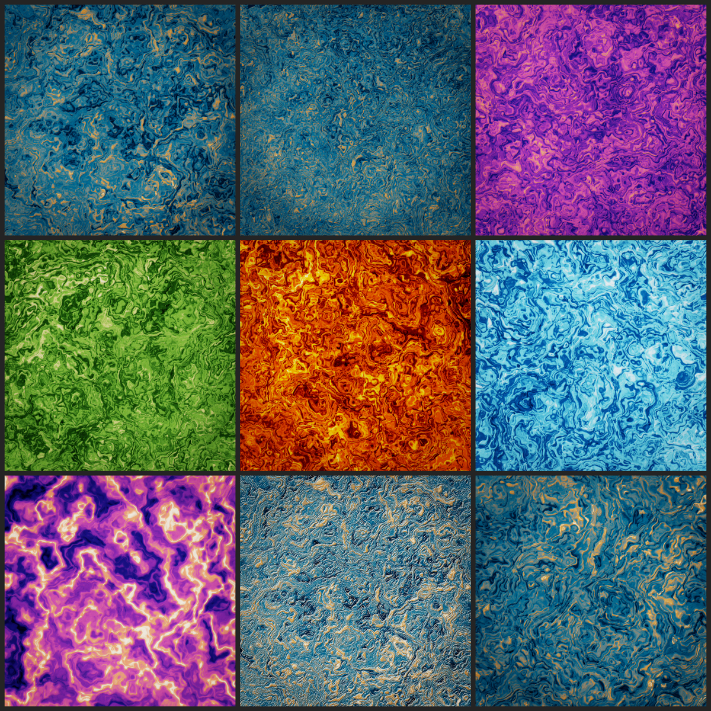

# Keenly

**CUDA 生成艺术工作室** —— 程序化生成电影画幅与 A1 海报尺寸的背景：
胶片颗粒、磨砂质感、有机流动、液态金属。一台可复现的「审美机器」。

核心设计一句话：**每个像素都是 `(x, y, seed)` 的纯函数**——
GPU 与 CPU 参考**逐位一致**（maxAbs = 0），同一个 seed 无限复现，
**换 seed 就是换构图，风格不变**。



---

## 快速开始

```powershell
# 构建（任选其一）
powershell -ExecutionPolicy Bypass -File scripts\build_direct.ps1   # 直接 nvcc
powershell -ExecutionPolicy Bypass -File scripts\build.ps1          # CMake + Ninja

# 电影画幅（2.39:1，16-bit PNG）
.\bin\keenly.exe --preset cinema --width 2560 --height 1072 --out out\film_frame.png

# A1 海报（594x841mm 比例）
.\bin\keenly.exe --preset dusk --width 2000 --height 2832 --out out\a1_poster.png

# 九宫格：一次看九种构图/风格组合
.\bin\keenly.exe --grid out\showcase_grid.png --tile 800

# 回归门禁（改动后跑这个）
powershell -ExecutionPolicy Bypass -File scripts\verify.ps1
```

A1 300 DPI 印刷母版：`--width 7014 --height 9933`（7000 万像素，
GPU 渲染约 0.4 秒；瓶颈在 PNG 写盘）。

---

## 架构

```
src/
  keenly.cu       CLI + 位级门禁 + 九宫格 showcase + PNG 写出
  noise.cuh       整数哈希、8 方向梯度噪声、fBm、ridged fBm、Worley、powi
  pixel.cuh       调色板、分层构图、7 个场生成器（GPU/CPU 共享的像素着色）
  render.h/.cu    field kernel + post 链（bright/blur/compose）
  reference.cu    CPU 参考（串行遍历，同 pixel shader）
  png_writer.h    零依赖 PNG 写出（RGB 8/16-bit，stored DEFLATE）
  compare.h       DiffStats / compareArrays（门禁比较）
  cuda_utils.h    CUDA_CHECK + GpuTimer
docs/
  pipeline.md     渲染管线技术文档（生成器/调色/后期/门禁原理）
  experiments.md  实验记录：改了什么 → 指标怎么变 → 为什么
scripts/
  build.ps1 / build_direct.ps1   两种构建路径
  verify.ps1                      回归门禁（构建 + 位级门禁 + 冒烟渲染）
```

**数据流**（详见 [docs/pipeline.md](docs/pipeline.md)）：

```
噪声 (5 octave fBm，每 octave 旋转 14°)
  → 二级域扭曲 (two-level domain warp)          ← 有机流动感
  → 分层构图（宏观明暗布局 + 色相漂移 + 细节层）   ← 「画」与「噪声贴图」的区别
  → 调色板 (6 stop) + 双尺度浮雕光照
  → 后期链 (线性光):
      halation 红晕 + bloom → split-tone 青影橙光 → vividness
      → 胶片颗粒 (双尺度聚团 + 三层色差) → 暗角 → ACES
  → sRGB + TPDF dither → 8/16-bit PNG
```

**分层构图**是 v2 的灵魂：宏观形体决定画面明暗布局、全画幅左上方向光、
色相随大形体漂移——`--macro 0` 关掉（平铺感）、`--macro 1` 全开（绘画感）。

---

## 生成器 × 调色板

**7 个场生成器**（`--mode`）：

| mode | 质感 | 数学 |
|---|---|---|
| `warp` | 流动烟雾 / 有机流体（默认，验证过的审美基线） | 二级域扭曲 fBm |
| `ridge` | 大理石纹 / 岩层 | 扭曲 ridged fBm |
| `bands` | 流线条纹 / 木纹 / 等高线 | warpField 三角波等值线 |
| `frost` | 磨砂玻璃 | 细 Worley 晶面 + 微闪点 |
| `facet` | 凛冽几何：晶体切面 / 碎裂 | Worley + 每面受光 + 硬闪 |
| `prism` | 凛冽几何：雪佛龙 / 菱格 | 30° 旋转坐标三角波折叠 |
| `liquid` | 光照质感：液态金属 / 油膜 | 宽场 + 宽高光 + 加性 glint |

**6 个调色板**（`--preset`）：`cinema`（青橙）、`dusk`（靛蓝-品红-珊瑚）、
`mono`（灰阶）、`ember`（火）、`ice`（冰川）、`moss`（森林）。
preset 附带各自的颗粒/光晕默认值，CLI 显式参数优先。

**质感旋钮**：`--grain` / `--grain-scale`（35mm 聚团 ↔ 磨砂细颗粒）、
`--halation`（胶片高光红晕）、`--split-tone`（青影橙光）、`--saturation`、
`--macro`（构图强度）、`--relief`（浮雕）、`--warp` / `--view`（结构）。
全部清单见 `keenly --help`。

---

## 工程纪律

**位级门禁**。Keenly 用严格 IEEE 数学编译（`--fmad=false`，不加 fast-math），
所以 GPU 渲染与 CPU 参考逐位一致——`keenly --check-all` 对全部 7 个生成器
要求 `maxAbs == 0`，`scripts\verify.ps1` 每次改动后跑。这不是过度工程：
它同时保证了 seed 系列的可复现性、未来分块渲染的无缝性、印刷母版的可重渲性。
历史教训（实验 1/2/3）都写在 [docs/experiments.md](docs/experiments.md) 里——
fast-math 的误差预算模型被 bands 的 fold 增益（126 倍）击穿后，才换成零误差的编译约定。

**纯函数纪律**。噪声只用整数哈希 + 多项式 + IEEE sqrt；高光用整数幂连乘
（不用 libm `pow`）；没有三角函数、没有全局状态。这是「换 seed 出系列」
和「任意尺寸/分块渲染」的根基。

**实验记录**。每个被数据推翻的假设都记在 [docs/experiments.md](docs/experiments.md)：
舍入底噪随链长增长、fold 的结构性增益、直方图形状判据（值域塌缩 vs 双峰）。

## 性能（RTX 2080 SUPER）

| 输出 | 尺寸 | field | post |
|---|---|---|---|
| 电影画幅 | 2560×1072 | ~36 ms | ~1.5 ms |
| A1 300 DPI | 7014×9933（70MP） | ~354 ms | ~24 ms |

渲染不是瓶颈，PNG 写盘是（当前 stored DEFLATE，零依赖零压缩）。

---

## 路线图

- [ ] tile + halo 分块渲染，打通 A1 600 DPI（单 buffer 3.35GB 超 8GB 显存）
- [ ] 逐帧换 seed 的动画路径（颗粒「沸腾」= 胶片感）→ ffmpeg 帧序列
- [ ] PNG fixed-Huffman 压缩，文件缩 2-5x
- [ ] 蓝噪声 void-and-cluster + 半调印刷质感
- [ ] curl-noise 粒子平流（水墨/风场线条）、Gray-Scott 反应扩散（珊瑚斑纹）
- [ ] halation 双线性回采样

---

*Keenly —— 锐利地看，温柔地渲染。*